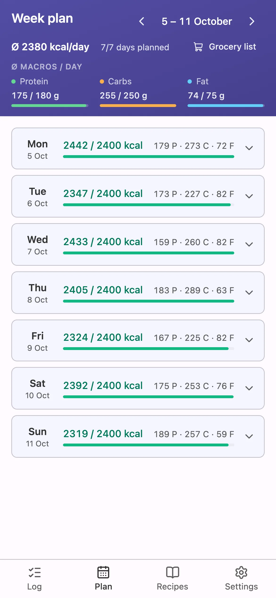

# forkcast

My take on meal planning and calorie tracking: I plan the week ahead against my calorie and macro goals, then cook and shop from that plan.

**[Try the demo](https://check-forkcast.tizzy.dev/demo/)** · [Why I built it](https://check-forkcast.tizzy.dev) · [Self-host it](#self-hosting)



## What it does

- **Plan the week** against your own calorie and macro goals, and see at a glance which days are over or under.
- **Recipes cook into ingredients.** Log a batch, eat it over several days, and the macros follow the portions.
- **Cook from the plan.** The cooking view lists what goes into the pot today; swap an ingredient for what you actually have and the plan updates.
- **Grocery list** for the week, with the things you already have ticked off, copied or sent to Bring!.
- **Packaged foods:** scan a barcode or search Open Food Facts next to your own food catalog.
- **Weight trend** with a 7-day average, and a calculator that suggests goals from your body data.
- **Optional AI** (bring your own Anthropic key): import a recipe from photos, capture a product from its packaging, match unknown ingredients to your catalog.
- **English and German**, as an installable PWA that works on the phone and on the desktop.

It's built for one person: a single password, no sign-up, no sharing.

## The demo

The [demo](https://check-forkcast.tizzy.dev/demo/) runs the whole app in your browser, on a week of sample data in your language. Nothing goes to a server, and your changes stay in your browser until you reset them. Features that need a server or an API key are switched off there: the AI features, Bring! export and the diagnostics screen. Product search uses a snapshot of popular Open Food Facts products.

## Self-hosting

forkcast runs as two public container images on Docker Hub, built from `main` for amd64 and arm64: [`tizzyapunkt/forkcast-backend`](https://hub.docker.com/r/tizzyapunkt/forkcast-backend) (API, data in a volume) and [`tizzyapunkt/forkcast-frontend`](https://hub.docker.com/r/tizzyapunkt/forkcast-frontend) (nginx serving the app and proxying `/api` to the backend). Neither image contains secrets or personal data; the only data shipped is the starting food catalog.

```bash
mkdir forkcast && cd forkcast
curl -LO https://raw.githubusercontent.com/tizzyapunkt/forkcast/main/docker-compose.yml
echo "AUTH_PASSWORD=choose-a-password" > .env
echo "AUTH_JWT_SECRET=$(openssl rand -hex 32)" >> .env
docker compose up -d
```

Then open `http://<host>:8080` and log in with the password. [`docker-compose.yml`](docker-compose.yml) runs both images with one data volume. [`backend/.env.example`](backend/.env.example) lists every setting; for the AI features set `ANTHROPIC_API_KEY` (the model defaults to Claude Sonnet). Without a key, the AI features stay hidden and everything else works.

**HTTPS:** installing the app to the home screen and the barcode scanner need a secure context, so put forkcast behind a reverse proxy with TLS (Caddy, Traefik, nginx, your NAS's built-in one) for anything beyond `localhost`.

**Updates:** `docker compose pull && docker compose up -d`. The data volume is kept, and an existing food catalog is never overwritten.

**Backups:** everything (log, recipes, goals, weight, catalog) lives in the `forkcast_data` volume as JSON files, so back up the volume. Settings → My foods → Download backup saves the food catalog alone.

## How it's built

A Hono API and a Vite + React PWA in one pnpm workspace. The backend is hexagonal: the domain speaks meal planning, and adapters persist it as plain JSON files (no database until one is needed). Every behaviour change starts as an [OpenSpec](https://openspec.dev) change, and [`openspec/specs/`](openspec/specs/) describes what the app does today. [`AGENTS.md`](AGENTS.md) has the conventions.

## Development

```bash
corepack enable && pnpm install
cp backend/.env.example backend/.env   # set AUTH_PASSWORD and AUTH_JWT_SECRET
pnpm dev                                # backend on :3000, frontend on :5173
make check                              # lint, typecheck, format, tests, builds
```

## License

[GNU Affero General Public License v3.0](LICENSE) (AGPL-3.0-only). Use it, fork it, run it for yourself. If you run a modified version as a service for others, you have to publish its source under the same license and keep the copyright and license notices, including the one in the app's settings.
